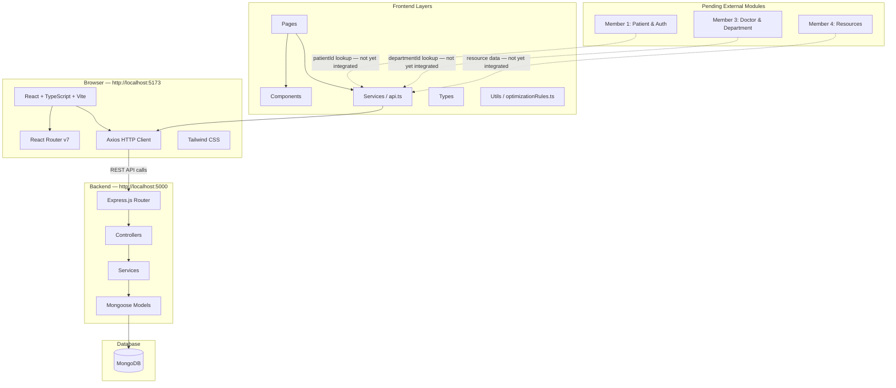

# Patient Flow Module — Architecture Documentation

**Project:** Patient Flow Optimization & Hospital Resource Coordination Platform  
**Module:** Member 2 — Patient Flow & Queue Management

---

## System Architecture



---

## Request Flow

```
User action in Browser
        │
        ▼
React Component (Page)
        │  calls service function
        ▼
Service Layer (queueService.ts / triageService.ts)
        │  wraps Axios, unwraps response envelope
        ▼
api.ts (Axios instance, baseURL = VITE_API_BASE_URL)
        │  HTTP request
        ▼
Express Router (routes/queueRoutes.js)
        │  matches path + method
        ▼
Controller (controllers/queueController.js)
        │  extracts params, calls service
        ▼
Service (services/queueService.js)
        │  all business logic
        ▼
Mongoose Model (models/QueueEntry.js)
        │  query + save
        ▼
MongoDB
        │  result
        ▼ (back up the same chain)
React Component renders result
```

---

## Frontend Architecture

### Layer Responsibilities

| Layer | Responsibility |
|---|---|
| Pages | Owns page-level state, orchestrates data fetching, handles loading/error/success |
| Components | Pure display — receive props, emit events, no API calls |
| Services | One function per API endpoint; unwraps response envelopes; never contains UI logic |
| Types | TypeScript interfaces matching exact backend response shapes |
| Utils | `optimizationRules.ts` — pure functions, no side effects, no API calls |

### Data Flow Rule

> **Components never call Axios directly.** All API communication goes through the service layer.

```
Page → Service → Axios → Express API
Page ← Service ← Axios ← Express API
```

### Key Design Decisions

1. **All queue business logic on the backend.** The frontend never calculates priority, queue position, EWT, or AWT. It displays values returned by the backend.

2. **Response envelope unwrapping in services.** The backend wraps all responses as `{ success, data }` (or `{ success, entries }` for the entries endpoint). Services unwrap these before returning — components receive plain objects.

3. **`includeAll` query parameter.** The entries endpoint defaults to WAITING-only (for management pages). Analytics, history, and optimization pages pass `?includeAll=true` to receive all statuses.

4. **Rule-based optimization engine.** `optimizationRules.ts` is a pure TypeScript module — zero API calls, zero side effects. It receives `QueueEntry[]` from the service and returns `OptimizationAnalysisResult`. This keeps the page reusable and testable.

---

## Backend Architecture

### Service Layer Responsibilities

| Service | Responsibility |
|---|---|
| `queueService.js` | Queue CRUD, join logic, duplicate prevention, ordered entry retrieval, EWT computation, position mapping |
| `queueStatusService.js` | Status transition validation, timestamp setting, AWT calculation |
| `priorityService.js` | Triage level → priority mapping (DB override or hardcoded fallback) |

### Priority Mapping

```
EMERGENCY → Priority 1 (highest — always first in queue)
URGENT    → Priority 2
NORMAL    → Priority 3
```

Queue ordering: `priority ASC, joinedAt ASC` (lowest number = first, earliest time = first within same priority).

### EWT Formula

```
EWT = (position − 1) × averageConsultationTime
```

Computed on every `GET /api/queues/:queueId/entries` request for WAITING entries only. Never stored permanently.

---

## Database Collections

| Collection | Purpose |
|---|---|
| `triagerecords` | Clinical triage assessments |
| `queues` | Department queue configuration |
| `queueentries` | Individual patient queue entries (full lifecycle) |
| `priorityrules` | Optional DB override for priority mapping |

### Key Indexes on QueueEntry

```js
{ queueId: 1, status: 1, priority: 1, joinedAt: 1 }  // compound
{ patientId: 1 }
{ queueId: 1 }
{ status: 1 }
{ priority: 1 }
{ joinedAt: 1 }
```

---

## Authentication Status

| Layer | Status |
|---|---|
| Backend route protection | ❌ Not implemented — pending Member 1's auth module |
| JWT verification middleware | ❌ Not available |
| Frontend token storage | ❌ Not implemented |
| Axios auth interceptor | ❌ Not implemented |
| Role-based UI visibility | ❌ Not implemented |

All Patient Flow APIs are currently public. Authentication will be added once Member 1 delivers their auth middleware.

---

## Cross-Module Integration Status

| Module | Status | Integration Point |
|---|---|---|
| Member 1 — Patient & Access | ❌ Not delivered | `patientId` in triage and queue join forms |
| Member 3 — Doctor & Department | ❌ Not delivered | `departmentId` in queue creation; department selector |
| Member 4 — Resources | ❌ Not delivered | Post-discharge resource allocation |

All integration points are designed and documented. The data models store the correct ObjectId references. Integration requires only replacing manual text inputs with API-driven selectors.

---

## Optimization Engine Architecture

```
PatientFlowOptimizationPage
        │ selects queue, clicks Analyze
        ▼
analyzeQueueFlow(queueId)  [optimizationService.ts]
        │ calls getQueue + getQueueEntries(includeAll=true)
        ▼
evaluateOptimizationRules(queueId, entries)  [optimizationRules.ts]
        │ pure function, no API calls
        ▼
OptimizationAnalysisResult
        │ metrics + recommendations[]
        ▼
OptimizationSummary + RecommendationCard[]  [components]
```

Rules evaluated (all transparent, no ML):

| Rule | Trigger |
|---|---|
| A | WAITING + Priority 1 patient exists |
| B | ≥5 WAITING patients |
| C | Any WAITING patient has EWT ≥30 min |
| D | Any CALLED patient exists |
| E | No WAITING patients |
| F | No COMPLETED patients |
